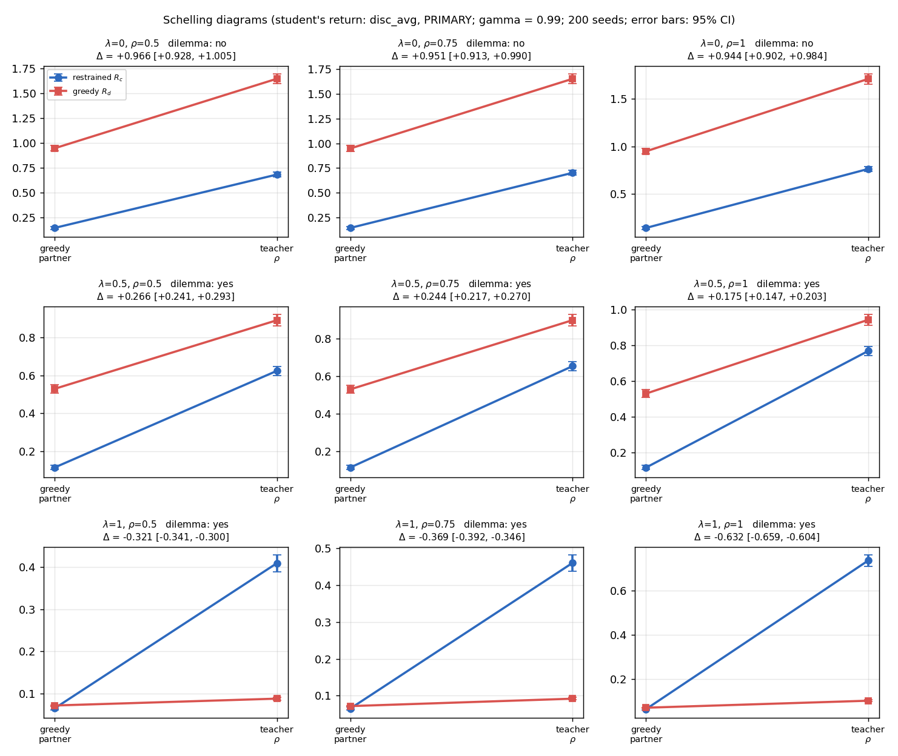
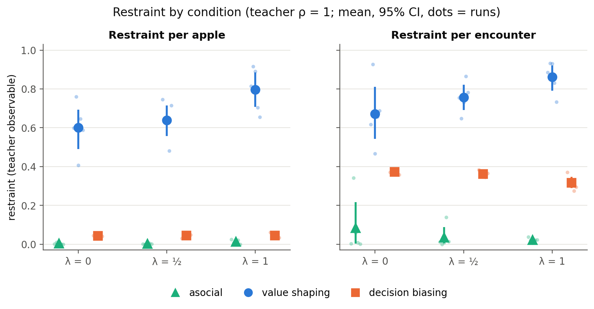
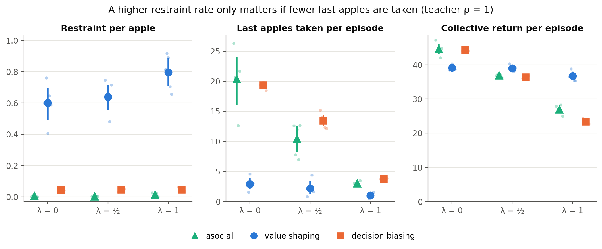
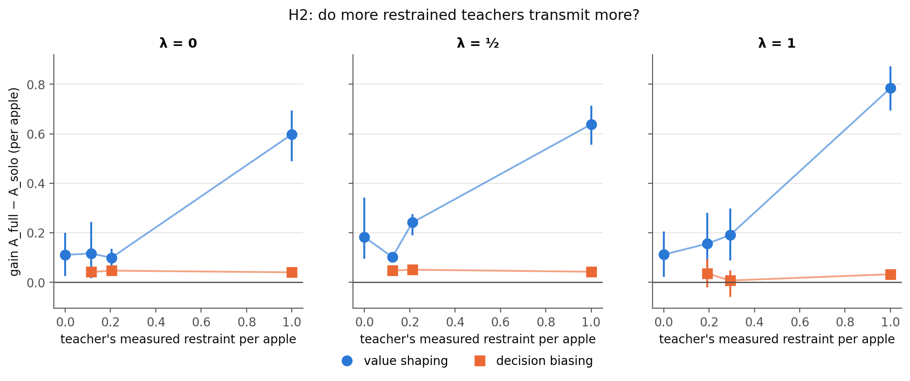
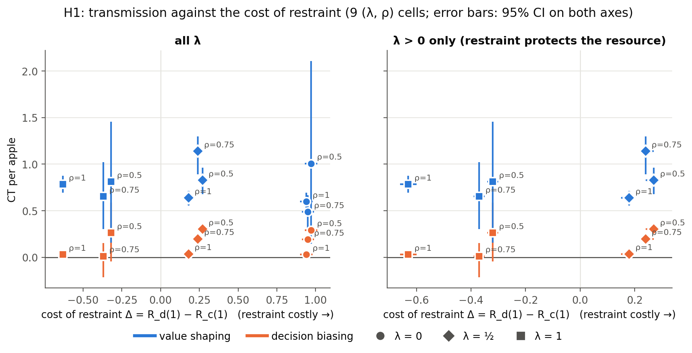
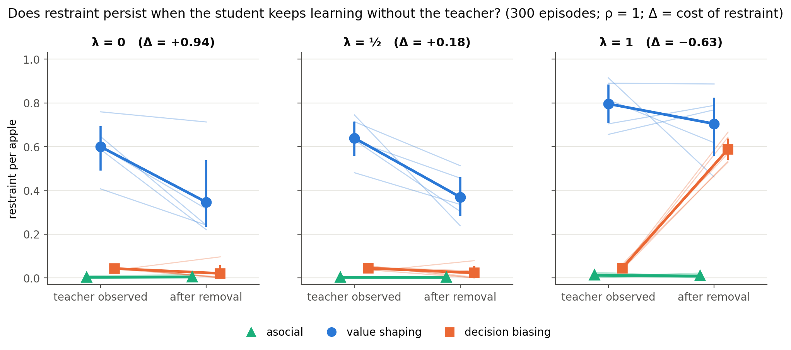
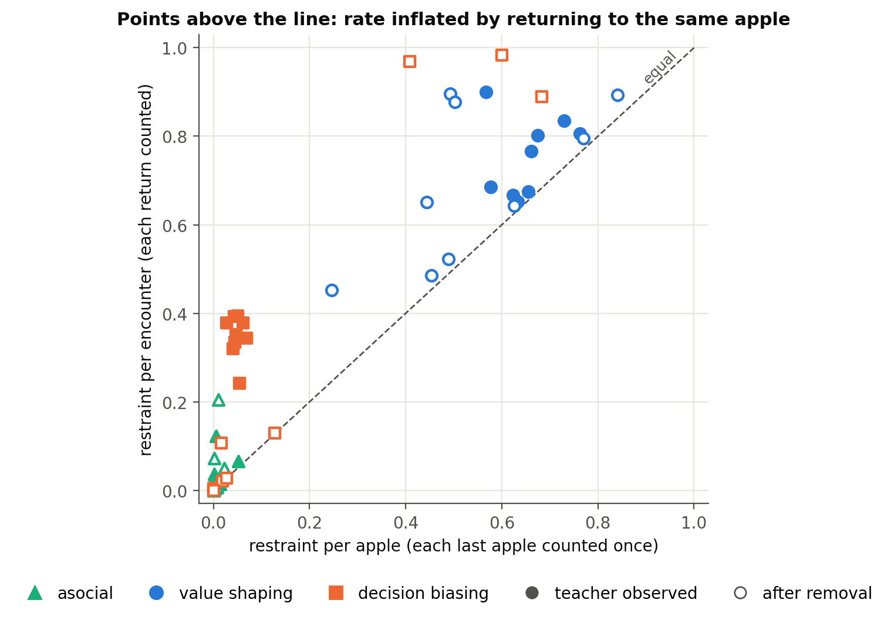

Can an agent that has learned to harvest a shared resource with restraint pass
that restraint on to a newcomer who only watches it, even when restraint costs
the newcomer reward?

This project studies that question with tabular reinforcement learning in a
small multi-agent gridworld. A frozen, restrained **teacher** and a naive,
learning **student** harvest apples from shared patches. Taking the last apple
of a patch can destroy the patch, so restraint protects the resource, but it
also means leaving reward behind. The student never sees the teacher's rewards
or values, only its positions and actions, and it is trained only on its own
reward. Whether, and how far, the teacher's restraint is transmitted is the
object of study.

**Author:** Mokwele Kegomoditswe, Department of Computer Science, University of Cape Town
**Supervisor:** Asad Jeewa

---

## Why this question

Research on **social learning** in reinforcement learning has shown that a naive
agent can acquire behaviour by observing an expert, but the behaviours studied
have been task skills that also benefit the learner, such as finding a goal or
shortening a route. Copying the expert was always in the learner's own interest.

Research on **social dilemmas** has shown how restraint and other cooperative
behaviours can be sustained among self-interested agents, but almost always
among peers that learn together, without a teacher.

This project sits between the two. In a common-pool resource, copying a
restrained harvester means earning less in the short term than a greedy
harvester would: the learner's own reward signal **opposes** the behaviour it
observes. Whether social learning still works when it has to compete with
self-interest is a different question from the ones already studied, and the
behaviours most worth transmitting between agents, such as restraint, fairness
and contribution to shared goods, are exactly the costly ones.

The project asks:

1. Does a restrained teacher transmit its restraint to a naive learner through
   observation alone?
2. How does transmission change as restraint becomes **more costly** for the learner?
3. How does it depend on **how restrained the teacher itself is**?
4. Does transmitted restraint **persist** once the teacher can no longer be observed?

---

## The environment

A two-agent gridworld written to the [PettingZoo](https://pettingzoo.farama.org/)
Parallel API, in the style of the *Commons Harvest* family of sequential social
dilemmas.

- **Grid:** $`10 \times 10`$ cells with four apple patches of five cells each.
- **Actions:** move up, down, left or right, or stay. Moves that would leave the
  grid are unavailable.
- **Reward:** $`+1`$ for moving onto an apple, which is then harvested.
- **Episodes:** a fixed length of $`T = 1500`$ steps.
- **Observation:** each agent sees apples within a radius of 4 cells, but
  observes the other agent's position and last action only within a radius
  of 2. The student must stay near the teacher to learn from it.

### Regrowth and the dilemma parameter $`\lambda`$

At every step, each empty patch cell regrows an apple with probability

```math
p(n;\lambda) = (1-\lambda)\,\bar p + \lambda\, p_{\mathrm{SJ}}(n),
```

where $`n`$ is the number of apples within a radius of two cells, $`\bar p = 0.001`$
is a constant rate, and $`p_{\mathrm{SJ}}`$ is the Commons Harvest regrowth rule:

| $`n`$ | 0 | 1 | 2 | $`\ge 3`$ |
|---|---|---|---|---|
| $`p_{\mathrm{SJ}}(n)`$ | 0 | 0.001 | 0.005 | 0.025 |

- At $`\lambda = 0`$, regrowth ignores the remaining stock: leaving an apple
  protects nothing, so restraint is **pointless** (the no-dilemma control).
- At $`\lambda = 1`$, a patch with no apples left **never regrows**.
- $`\lambda = \tfrac12`$ lies between the two.

The experiments use $`\lambda \in \{0, \tfrac12, 1\}`$.

### Restraint

An apple is **protected** when it is the last apple left in its patch, and
**restraint** means declining to take it. Restraint is about avoiding
depletion, not about harvesting as little as possible.

---

## Agents

### Scripted policies

- **Restrained** $`\pi_R`$: heads for the nearest apple but never takes a last apple.
- **Greedy** $`\pi_G`$: heads for the nearest apple and takes any apple, including last apples.

The two differ only at a **restraint opportunity**, a step at which a last apple
is adjacent. **Teacher levels** mix them there:

```math
\pi_T^{\rho} = \rho\pi_R + (1-\rho)\pi_G, \qquad \rho \in \{0,\ 0.5,\ 0.75,\ 1\},
```

so the teacher takes an adjacent last apple with probability $`1-\rho`$ at each
step. Because taking an apple changes later opportunities, the nominal $`\rho`$
is not the realised restraint rate; the realised rate is **measured** and used
as the teacher's level. The control teacher $`\rho = 0`$ moves and waits like
$`\pi_R`$ but always takes an adjacent last apple. Because a learner trained alone does not learn
restraint (see Results), the teacher's restrained policy is the scripted $`\pi_R`$.

### The learner

A tabular Q-learner with learning rate $`\alpha`$ and discount factor $`\gamma`$:

```math
Q(s,a) \leftarrow Q(s,a) + \alpha \Big[ r + \gamma \max_{a'} Q(s',a') - Q(s,a) \Big],
```

acting through a softmax policy with inverse temperature $`\beta`$:

```math
\pi(a \mid s) = \frac{\exp\big(\beta Q(s,a)\big)}{\sum_{b} \exp\big(\beta Q(s,b)\big)}.
```

Episodes end by truncation, so the update always bootstraps from the next
state. Default settings: $`\alpha = 0.1`$, $`\gamma = 0.99`$, $`\beta = 5`$, initial values $`Q = 1`$.

The learner's state is a compact summary of what it sees (90 states):

| Feature | Values | Meaning |
|---|---|---|
| food | 9 | direction of the nearest ordinary apple, or of the grid centre if none is visible |
| protected direction | 5 | direction of the nearest last apple, or none |
| protected adjacent | 2 | whether that last apple is one step away (a restraint opportunity) |

### Social learning mechanisms

Two non-inferential mechanisms let the student use what it observes. Neither
gives it access to the teacher's rewards or values.

**Value shaping** raises the value of each state-action pair $`(s_e, a_e)`$ the
teacher is observed to take:

```math
Q(s_e, a_e) \leftarrow Q(s_e, a_e) + \kappa.
```

**Decision biasing** mixes the student's own policy with a social policy that
moves towards the teacher's last observed position:

```math
\pi_{\mathrm{DB}} = (1-\omega)\,\pi_{\mathrm{asoc}} + \omega\,\pi_{\mathrm{soc}}.
```

These are the two social reinforcement-learning models compared by Najar et
al. (2020), who found that value shaping best describes how people learn from
others' actions. An **asocial** student, which receives no information about
the teacher, is the control. Value shaping acts only through learning; decision biasing acts at the
moment of choice, during training and evaluation alike.

The strengths $`\kappa`$ and $`\omega`$ were fixed before the main runs by a rule
chosen in advance: at $`\lambda = 0`$, with the fully restrained teacher, pick the
value that transmits **partially**, closest to halfway between the asocial
student and the teacher. This gave $`\kappa = 0.03`$ and $`\omega = 0.5`$, held
fixed in every condition.

---

## Measurement

### Restraint rate

A restraint opportunity is an **encounter**: the agent arrives next to a last
apple it was not next to on the previous step. Waiting beside the same apple is
one decision, however long it lasts. For agent $`i`$,

```math
\mathrm{Res}_i = 1 - \frac{\text{last apples taken by } i}{\text{encounters of } i},
```

excluding encounters ended by the other agent taking the apple first. A
per-step variant, counting every step spent beside a last apple, is reported as
a secondary measure; it is inflated when a restrained agent waits.

The pilot showed that the encounter count can be inflated too: a learner that
steps back and forth beside a last apple starts a new encounter on every
return (see Results). Restraint is therefore also measured **per apple**, where
each last apple counts once however often the agent comes back to it:

```math
\mathrm{Res}^{\mathrm{apple}}_i = 1 - \frac{\text{last apples taken by } i}{\text{distinct last apples } i \text{ was next to}},
```

where a "last apple" is one patch's spell in the last-apple state, from the
moment the patch is reduced to one apple until that apple is taken or the patch
regrows, and apples taken first by the other agent are excluded. Both rates are
reported; the per-apple rate is the **primary measure** of the full study
(adopted after the pilot, before the full study ran).

Restraint is always read together with **collective return**, **survival time**
(steps until every patch is empty) and **patch losses by cause**, including
patches emptied when both agents take the last two apples in the same step,
which no individual restraint measure records.

### Is it a social dilemma? The cost of restraint

With $`R_c(\ell)`$ and $`R_d(\ell)`$ the student's return when it restrains or is
greedy and $`\ell \in \{0,1\}`$ other agents restrain, the game is a **social
dilemma** if

```math
R_c(1) > R_d(0), \qquad R_c(1) > R_c(0),
```

and at least one temptation holds: **fear**, $`R_d(0) > R_c(0)`$, or **greed**,
$`R_d(1) > R_c(1)`$. The **cost of restraint** is the greed gap

```math
\Delta = R_d(1) - R_c(1)
```

This is the extra return a student gets by taking last apples while its teacher
restrains. Restraint is individually costly exactly when $`\Delta > 0`$.

Returns are measured as the student experiences them: discounted with its own
$`\gamma`$, from **every** step of the episode, and averaged,

```math
\bar G = \frac{1}{T}\sum_{t=0}^{T-1} G_t, \qquad G_t = \sum_{k \ge 0} \gamma^{k}\, r_{t+k+1},
```

since the learner values every state it visits, not only the first.
Undiscounted returns and returns discounted from the start of the episode are
also reported.

### Transmission, persistence and partners

Every trained student is evaluated with learning switched off, on the same
evaluation episodes, in these settings:

| Setting | What changes | What it measures |
|---|---|---|
| full | the student observes the teacher throughout | $`A_{\mathrm{full}}`$ |
| half | observation is switched off halfway through each episode | $`A_{\mathrm{half}}`$ |
| off | the student never observes the teacher | behaviour without the teacher's information |
| after removal | the student **keeps learning** for 300 episodes without observing the teacher, then is evaluated | whether restraint **persists** when only the student's own reward shapes it |
| partners | the student plays beside a greedy agent, or beside a naive learner that learns as it plays | whether restraint holds with different partners |

Transmission is measured with the **cultural transmission** metric, applied to
restraint:

```math
\mathrm{CT} = \frac{1}{2}\,\frac{A_{\mathrm{full}} - A_{\mathrm{solo}}}{E} + \frac{1}{2}\,\frac{A_{\mathrm{half}} - A_{\mathrm{solo}}}{E},
```

where $`A_{\mathrm{full}}`$, $`A_{\mathrm{half}}`$ and $`A_{\mathrm{solo}}`$ are the
student's restraint with the teacher observable throughout, observable for the
first half of each episode, and never observable (the asocial student), and $`E`$
is the teacher's own restraint. $`\mathrm{CT} = 1`$ means the student matched the
teacher, and a confidence interval that includes zero means no evidence of
transmission. Because $`\mathrm{CT}`$ divides by the teacher's own restraint, the
effect of the teacher's level is compared with the **raw gain**
$`G = A_{\mathrm{full}} - A_{\mathrm{solo}}`$ instead, and CT is unreliable when
$`E`$ is small. Part of the gain may come from copying the teacher's waiting
rather than its restraint, so a control teacher that never restrains
($`\rho = 0`$) gives the **restraint-specific** gain

```math
S(\rho) = G(\rho) - G(0).
```

The unit of analysis is the
independent training run; results are means with 95% bootstrap confidence
intervals over runs.

---

## Results

### The environment is a social dilemma where it should be

Scripted restrained and greedy students were paired with a greedy partner and
with the teacher at each level, with **200 seeds per pairing**. Returns are
measured as the learner experiences them (discounted with $`\gamma = 0.99`$,
averaged over all steps). A condition counts only when its 95% interval
excludes zero.

| $`\lambda`$ | Social dilemma? | Greed gap $`\Delta`$ [95% CI], teacher level $`\rho = 0.5`$ | $`\rho = 0.75`$ | $`\rho = 1`$ |
|---|---|---|---|---|
| 0 | no | $`+0.97\ [0.93, 1.01]`$ | $`+0.95\ [0.91, 0.99]`$ | $`+0.94\ [0.90, 0.98]`$ |
| $`\tfrac12`$ | **yes** (fear and greed), at every level | $`+0.27\ [0.24, 0.29]`$ | $`+0.24\ [0.22, 0.27]`$ | $`+0.18\ [0.15, 0.20]`$ |
| 1 | **yes** (fear only), at every level | $`-0.32\ [-0.34, -0.30]`$ | $`-0.37\ [-0.39, -0.35]`$ | $`-0.63\ [-0.66, -0.60]`$ |

- **$`\lambda = 0`$** is the control: restraint costs the student reward and protects nothing.
- **$`\lambda = \tfrac12`$** is the core condition: restraint is both **individually
  costly** ($`\Delta > 0`$) and **collectively valuable** (a social dilemma), at
  every teacher level.
- **$`\lambda = 1`$** is a dilemma only through fear; beside the teacher,
  restraint **pays** the student ($`\Delta < 0`$).
- At $`\lambda = \tfrac12`$ the cost of restraint **falls as the teacher becomes
  more restrained**: a restrained teacher keeps patches alive, so restraint
  costs the student less. Teacher level and cost are therefore linked, and
  transmission is analysed against the measured $`\Delta`$ of each condition.
- Measured from the start of an episode instead, no setting is a dilemma:
  within the learner's horizon from the start, restraint never pays back.



### A lone learner does not learn restraint

A Q-learner trained alone at $`\lambda = 1`$ ended up no more restrained than a
greedy agent, in all three seeds, even though restraint doubles a lone agent's
harvest:

| | Restraint per encounter | Return |
|---|---|---|
| learner, seed 0 | 0.03 | 22.9 |
| learner, seed 1 | 0.00 | 21.3 |
| learner, seed 2 | 0.78 | 20.3 |
| scripted greedy $`\pi_G`$ | 0.00 | 20.2 |
| scripted restrained $`\pi_R`$ | 1.00 | 41.0 |

Seed 2's high rate is misleading on its own: it repeatedly walks up to last
apples and leaves, but still takes about three per episode, and its return is
no better than greedy. This is why restraint is always read together with the
apples actually taken and the return.

The environment is not at fault: restraint doubles the harvest, and averaged
over the states the learner visits, its own discounted objective favours
restraint. But the reward for taking a last apple is immediate, while its cost
arrives hundreds of steps later, and the learner's state does not reveal how
far into the episode it is. **Restraint is profitable but hard to learn alone**,
which is exactly the situation in which a teacher could help. The teacher in
the experiments is therefore the scripted restrained policy $`\pi_R`$.

### The teacher levels

Measured alone at $`\lambda = 1`$ over 50 episodes:

| Teacher level $`\rho`$ | Restraint per encounter [95% CI] | Last apples taken per episode | All patches died |
|---|---|---|---|
| 0.5 | 0.25 [0.20, 0.29] | 3.60 | 62% |
| 0.75 | 0.43 [0.37, 0.48] | 3.54 | 58% |
| 1 | 1.00 [1.00, 1.00] | 0.00 | 0% |

The realised restraint is well below the nominal $`\rho`$, because the teacher
draws at **every step** a last apple is adjacent, and often waits beside one for
several steps. Counted **per apple**, as in the full study, the partly
restrained teachers leave even fewer last apples untaken: 0.12–0.19
($`\rho = 0.5`$) and 0.20–0.29 ($`\rho = 0.75`$) across $`\lambda`$, because they
meet the same apple several times and usually take it in the end. A control
teacher at $`\rho = 0`$ moves and waits exactly like $`\pi_R`$ but always takes an
adjacent last apple (restraint 0).

---

### Full study

The full study tested predictions written down and committed **before** it ran
([PREDICTIONS.md](PREDICTIONS.md)), on fresh seeds that played no part in
choosing the design, the parameters or the measures:

- **Teachers:** $`\rho = 0.5,\ 0.75,\ 1`$, plus the $`\rho = 0`$ control.
- **Students:** asocial, value shaping ($`\kappa = 0.03`$) and decision biasing
  ($`\omega = 0.5`$); asocial and value shaping only beside the control.
- **Dilemma:** $`\lambda \in \{0, \tfrac12, 1\}`$.
- **Runs:** 5 independent seeds per cell (1000–1004), **165 students**, none
  failed or excluded.

The primary measure is restraint **per apple**. Intervals are 95% bootstrap
intervals over runs. `scripts/test_predictions.py` computes every prediction
from the results.

#### Value shaping transmits restraint from a fully restrained teacher

With the fully restrained teacher ($`\rho = 1`$) observable throughout:

| | $`\lambda`$ | Restraint per apple | (per encounter) | Last apples taken per episode | Collective return | CT per apple [95% CI] |
|---|---|---|---|---|---|---|
| asocial | 0 | 0.00 | (0.08) | 20.3 | 44.5 | |
| asocial | $`\tfrac12`$ | 0.00 | (0.04) | 10.4 | 36.8 | |
| asocial | 1 | 0.01 | (0.02) | 3.0 | 26.9 | |
| value shaping | 0 | **0.60** | (0.67) | 2.9 | 39.1 | 0.60 [0.49, 0.69] |
| value shaping | $`\tfrac12`$ | **0.64** | (0.76) | 2.2 | 39.0 | 0.64 [0.56, 0.71] |
| value shaping | 1 | **0.80** | (0.86) | 1.0 | 36.8 | 0.78 [0.69, 0.87] |
| decision biasing | 0 | 0.04 | (0.37) | 19.3 | 44.3 | 0.03 [0.03, 0.03] |
| decision biasing | $`\tfrac12`$ | 0.04 | (0.36) | 13.5 | 36.3 | 0.04 [0.03, 0.04] |
| decision biasing | 1 | 0.05 | (0.32) | 3.8 | 23.3 | 0.03 [0.02, 0.05] |



**The outcomes follow the dilemma.** Value-shaping students cut the last
apples taken from about 20 to 3 per episode at $`\lambda = 0`$. Compared with
asocial students, their own return and the collective return change by:

| $`\lambda`$ | Student | Collective | Reading |
|---|---|---|---|
| 0 | $`-12.4`$ | $`-5.4`$ | restraint is wasted: patches regrow anyway |
| $`\tfrac12`$ | $`-4.0`$ | $`+2.2`$ | a social dilemma: the student pays, the pair gains |
| 1 | $`+1.3`$ | $`+9.9`$ | restraint pays the student and the pair |

This is also the cost of restraint as the **learners themselves** experience it,
and it falls in the same order as $`\Delta`$, which was measured with scripted
students.



#### Students copy restraint, not only waiting, but only from a consistent teacher

Beside the $`\rho = 0`$ control, which moves and waits like the restrained teacher
but takes every last apple it reaches, value-shaping students still leave a few
last apples: some of what value shaping transmits is general waiting. The
**restraint-specific** part is the gain beside a teacher minus the gain beside
the control. Gain over asocial students, per apple:

| $`\lambda`$ | Control $`\rho = 0`$ | $`\rho = 0.5`$ | $`\rho = 0.75`$ | $`\rho = 1`$ | Restraint-specific, $`\rho = 1`$ |
|---|---|---|---|---|---|
| 0 | 0.11 [0.03, 0.20] | 0.12 [0.02, 0.24] | 0.10 [0.07, 0.14] | 0.60 [0.49, 0.69] | 0.49 [0.35, 0.62] |
| $`\tfrac12`$ | 0.18 [0.10, 0.34] | 0.10 [0.08, 0.12] | 0.24 [0.19, 0.28] | 0.64 [0.56, 0.71] | 0.46 [0.28, 0.59] |
| 1 | 0.11 [0.02, 0.21] | 0.16 [0.03, 0.28] | 0.19 [0.09, 0.30] | 0.78 [0.69, 0.87] | 0.67 [0.54, 0.80] |

Teachers that leave only 12–29% of last apples untaken transmit **no more than
the control**: their restraint-specific gain is indistinguishable from zero in
all six cells. Only the fully restrained teacher transmits restraint. A
plausible reason is that value shaping raises the value of whatever the teacher
does, so a teacher that sometimes takes the last apple also teaches taking it.
No teacher level lies between 0.3 and 1, so these results cannot tell a sharp
threshold from a steep rise in that range.



#### Costlier restraint is transmitted less

With the fully restrained teacher, transmission rises as the cost of restraint
falls: CT 0.60 at $`\lambda = 0`$ ($`\Delta = +0.94`$), 0.64 at $`\lambda = \tfrac12`$
($`\Delta = +0.18`$) and 0.78 at $`\lambda = 1`$ ($`\Delta = -0.63`$); the difference
between $`\lambda = 0`$ and $`\lambda = 1`$ is $`-0.19\ [-0.28, -0.09]`$. The pilot,
with three runs, had shown no clear effect, and the prediction based on it was
wrong. The result supports the proposal's hypothesis that costly restraint is
transmitted less. $`\lambda`$ also changes how the resource behaves, not only
the cost, so this is an association with cost rather than a pure effect of it.



#### Transmitted restraint persists after the teacher is removed

Restraint per apple before and after 300 further episodes in which the student
learns from its own reward without observing the teacher ($`\rho = 1`$):

| | $`\lambda = 0`$ | $`\lambda = \tfrac12`$ | $`\lambda = 1`$ |
|---|---|---|---|
| cost of restraint $`\Delta`$ | $`+0.94`$ | $`+0.18`$ | $`-0.63`$ |
| value shaping, before → after | 0.60 → 0.35 | 0.64 → 0.37 | 0.80 → 0.71 |
| decision biasing, before → after | 0.04 → 0.02 | 0.04 → 0.02 | 0.05 → 0.59 * |
| asocial, after | 0.00 | 0.00 | 0.01 |

Value-shaping restraint stays well above that of asocial students in every
condition (retained 0.34, 0.37 and 0.70). It erodes least where restraint pays
($`\lambda = 1`$), but erosion at $`\lambda = 0`$ and $`\tfrac12`$ is similar, so the
pilot's suggestion that erosion follows cost was **not confirmed**.

\* Not transmission: after removal these students loop between two cells
beside last apples, so they leave apples by circling rather than by a sensible
policy (see the pilot below).



#### Decision biasing transmits almost nothing

Its gain over asocial students is 0.01–0.05 per apple in every cell, whatever
the teacher's restraint. With weakly restrained teachers its CT exceeds 0.1,
but only because CT divides by the teacher's low restraint. **CT is unreliable
when the teacher's own restraint is small**; the raw and restraint-specific
gains are the measures to read there.

#### Partners

With learning off, value-shaping students leave fewer last apples beside a
greedy agent (per apple 0.33, 0.25, 0.37) or a naive learner (0.40, 0.47, 0.68)
than beside their own teacher (0.60, 0.64, 0.80). Since their values do not
change in this test, this shows that restraint depends on the context it was
learned in, not that greedy company erodes it.

#### The predictions

| Prediction | Outcome |
|---|---|
| P1 restraint-specific transmission in every cell | supported with the fully restrained teacher (3 of 3); not with the partly restrained teachers (6 inconclusive) |
| P2 restrained teacher beats the control | supported (3 of 3) |
| P3 more restrained teachers transmit more | supported (3 of 3), as a jump at full restraint rather than a gradual rise |
| P4 no clear effect of cost on transmission | **not as predicted**: costlier restraint is transmitted less |
| P5a restraint persists after removal | supported (9 of 9) |
| P5b erosion follows cost | inconclusive |
| P6 decision biasing transmits almost nothing | supported with the fully restrained teacher; contradicted by CT in 4 cells with weak teachers, where CT is unreliable (raw gain at most 0.05) |

---

### Pilot *(3 runs per condition, $`\rho = 1`$; exploratory)*

The pilot ran the design at a small scale before the full study. It is
superseded by the full study, whose results at $`\rho = 1`$ replicate it, but it
led to three changes made before the full study ran:

- **Restraint per apple.** One group of decision-biasing students, after
  removal, alternated between two cells beside last apples, a loop caused by
  two cells mapping to states whose best actions point at each other. Every
  return started a new encounter (up to 121 per episode, against about 3
  normally), so per-encounter restraint read 0.95; per apple it was 0.56, and
  the students' own return was lower than asocial students'. Per-apple
  restraint became the primary measure.
- **The $`\rho = 0`$ control.** Teachers stand still for most of the episode, so
  value shaping might transmit waiting rather than restraint. In the pilot
  control, value-shaping students showed a small gain (0.07–0.21) against
  0.62–0.67 beside the restrained teacher, which led to the restraint-specific
  measure.
- **Predictions written down in advance**, for the full study.

| | $`\lambda`$ | Restraint per apple | (per encounter) | CT per apple [95% CI] |
|---|---|---|---|---|
| value shaping | 0 | 0.65 | (0.83) | 0.65 [0.57, 0.73] |
| value shaping | $`\tfrac12`$ | 0.62 | (0.67) | 0.62 [0.58, 0.65] |
| value shaping | 1 | 0.69 | (0.76) | 0.67 [0.60, 0.74] |
| decision biasing | 0 | 0.05 | (0.37) | 0.04 [0.03, 0.05] |
| decision biasing | $`\tfrac12`$ | 0.04 | (0.37) | 0.03 [0.02, 0.04] |
| decision biasing | 1 | 0.06 | (0.30) | 0.03 [−0.00, 0.05] |



**Restraint looks like waiting, not passivity.** Once every patch is down to its
last apple, nothing is harvestable for 86–93% of steps, and the scripted
teacher stands still for most of the episode. Value-shaping students wait
beside the last apple, but almost never stand still while an ordinary apple is
in view (0.3–0.6% of steps; the teacher 3–7%). Their loss of return is the last
apples they leave, not food they ignore.

---

### What the results show

- **Observation can transmit a behaviour the learner's own reward opposes**, but
  only from a consistent model. Beside a fully restrained teacher, value-shaping
  students left most last apples even where taking them pays; beside teachers
  that usually took them in the end, they learned no more restraint than beside
  one that always did.
- **What is copied matters.** Value shaping changes what the learner values, and
  its restraint outlasts the teacher. Decision biasing changes where the learner
  goes: following a restrained teacher leads the student to temptation without
  the values to resist it. Value shaping is also the mechanism that best
  describes how people learn from others' actions (Najar et al., 2020).
- **Cost matters for acquisition.** Restraint was transmitted less where it cost
  the learner more; where it pays but is hard to discover alone
  ($`\lambda = 1`$), observation let learners reach a policy they did not find by
  themselves.
- **Measures of restraint are easily inflated.** Back-and-forth movement
  inflates per-encounter rates, waiting inflates per-step rates, and CT
  overstates transmission from weakly restrained teachers. Restraint is read
  against last apples taken, collective return and the control teacher.

### Limitations and next steps

- **The cost of restraint.** All students are learners, but $`\Delta`$ is computed
  with the scripted policies in the student's seat, since only they are
  perfectly restrained or perfectly greedy. The learners' own returns fall in
  the same order.
- **Unequal views.** The teacher sees the whole grid; the student sees apples
  within four cells. A student that sees no other apple has little reason to
  leave a protected one. A full-view condition, used from training onwards,
  would test this.
- **A coarse state.** The three-feature state produces the looping described
  above.
- **Teacher levels.** No teacher lies between 0.3 and 1 restraint per apple;
  teachers at $`\rho = 0.9`$ or $`0.95`$ would show where transmission begins.
- **One environment.** A second environment (a different layout or a different
  social dilemma) would show whether the results generalise beyond this map.
- **Greedy company.** Whether restraint erodes faster when the student keeps
  *learning* beside a greedy partner is untested.

## Project status

| Stage | Contents | Status |
|---|---|---|
| Environment | gridworld, scripted policies, social-dilemma validation | complete |
| Teacher | three measured teacher levels and the $`\rho = 0`$ control | complete |
| Students | asocial, value shaping, decision biasing; parameter selection | complete |
| Pilot | 3 runs per condition; per-apple measure; $`\rho = 0`$ control | complete |
| Full study | 165 students on fresh seeds; predictions tested | complete |
| Write-up | report; second environment (to be agreed) | in progress |

---

## Project structure

```
commons_env/              the environment
  env.py                  gridworld, regrowth, social channel, restraint bookkeeping
  scripted.py             restrained, greedy and teacher-level policies
  metrics.py              restraint rate, per encounter and per step
agents/                   learning agents
  features.py             the learner's state; wall mask
  q_learner.py            tabular Q-learning with softmax
  runner.py               training and evaluation episodes; frozen teacher
  social.py               value shaping and decision biasing
scripts/
  check_gate.py           social-dilemma validation and the cost of restraint
  train_teacher.py        train a Q-learner teacher alone
  make_teacher_levels.py  build and measure the three teacher levels
  train_student.py        train one student beside the teacher
  run_batch.py            train many students in parallel (resumable)
  summarise_students.py   summarise trained students by condition
  select_social_param.py  choose kappa and omega by the rule fixed in advance
  stillness_check.py      teacher and student stillness: waiting or passivity?
  phase3_eval.py          transmission, persistence after removal, partner tests
  summarise_phase3.py     CT, raw gain and persistence with bootstrap intervals
  test_predictions.py     tests the predictions of PREDICTIONS.md
  make_figures.py         all figures, from a results folder
  view.py                 graphical viewer; loads trained students; records MP4 video
tests/                    unit and integration tests
results/                  outputs, kept in full, including unsuccessful runs
EXPERIMENT_LOG.md         a dated record of every run and decision
PREDICTIONS.md            the full study's predictions, committed before it ran
```

---

## Installation

Requires Python 3.11 or newer. From the project folder:

**Windows (PowerShell)**

```powershell
python -m venv .venv
.venv\Scripts\Activate.ps1
python -m pip install -r requirements.txt
python -m pip install -e .
python -m pytest -q
```

**macOS / Linux**

```bash
python3 -m venv .venv
source .venv/bin/activate
python -m pip install -r requirements.txt
python -m pip install -e .
python -m pytest -q
```

All tests should pass. They include PettingZoo's official API and determinism checks.

---

## Usage

**Watch the environment** (both agents scripted):

```bash
python scripts/view.py                                      # restrained teacher, greedy student
python scripts/view.py --student restrained                 # restrained student
python scripts/view.py --lam 0.5 --teacher mixed --rho 0.5  # a less restrained teacher
```

Controls: SPACE pause, RIGHT one step, UP/DOWN speed, R new episode, S screenshot,
V start/stop recording an MP4 video (saved in `results/videos/`), ESC quit.

**Watch a trained student**, or record one directly:

```bash
python scripts/view.py --lam 0.5 --student-q results/pilot/value_shaping_k0.03_lam0.5_rho1.0_s0.npz --social
python scripts/view.py --lam 0.5 --student-q <student>.npz --social --record clip.mp4 --record-steps 600
```

**Check that the environment is a social dilemma** and measure the cost of restraint:

```bash
python scripts/check_gate.py --seeds 50
```

**Train a teacher** alone at $`\lambda = 1`$ and check whether it is reliably restrained:

```bash
python scripts/train_teacher.py --seed 0
```

**Build and measure the three teacher levels**:

```bash
python scripts/make_teacher_levels.py --teacher scripted
```

**Train students** (one run, or a resumable batch in parallel) and summarise them:

```bash
python scripts/train_student.py --condition value_shaping --kappa 0.03 --lam 0.5 --seed 0
python scripts/run_batch.py --conditions asocial value_shaping decision_biasing --kappa 0.03 --omega 0.5 \
    --lams 0.0 0.5 1.0 --rho 1.0 --seeds 0 1 2 --out-dir results/pilot
python scripts/summarise_students.py results/pilot
```

**Evaluate transmission, persistence and partners**, then summarise:

```bash
python scripts/phase3_eval.py results/pilot
python scripts/summarise_phase3.py results/pilot
python scripts/stillness_check.py results/pilot
```

**Make the figures** (saved in `results/pilot/figures/`):

```bash
python scripts/make_figures.py results/pilot
```

**Reproduce the full study** (about 14 hours of training and 8.5 hours of
evaluation with 3 workers), then test the predictions:

```bash
python scripts/run_batch.py --conditions asocial value_shaping decision_biasing --kappa 0.03 --omega 0.5 \
    --lams 0.0 0.5 1.0 --rho 0.5 0.75 1.0 --seeds 1000 1001 1002 1003 1004 --out-dir results/full
python scripts/run_batch.py --conditions asocial value_shaping --kappa 0.03 \
    --lams 0.0 0.5 1.0 --rho 0.0 --seeds 1000 1001 1002 1003 1004 --out-dir results/full
python scripts/phase3_eval.py results/full
python scripts/summarise_phase3.py results/full
python scripts/test_predictions.py results/full
python scripts/make_figures.py results/full
```

---

## Reproducibility

- Every run is seeded; the same command reproduces the same numbers exactly.
- Training and evaluation use disjoint random seeds; the full study's seeds
  (1000–1004) were never used in the pilot or in choosing parameters.
- The full study's predictions and analysis script were committed before it ran.
- Package versions are pinned in `requirements.txt`.
- `EXPERIMENT_LOG.md` records every run that informed a decision, including
  failed ones, with the exact command and the reason for it.

---

## Key references

- Bhoopchand, A. et al. (2023). Learning few-shot imitation as cultural transmission. *Nature Communications*, 14, 7536.
- Cook, J., Lu, C., Hughes, E., Leibo, J. Z. and Foerster, J. (2024). Artificial generational intelligence: Cultural accumulation in reinforcement learning. *NeurIPS*.
- Guo, Z. et al. (2026). SocialJax: An evaluation suite for multi-agent reinforcement learning in sequential social dilemmas. *ICLR*.
- Keßler, S., Bautista-Salinero, M., Tennie, C. and Wu, C. M. (2026). Emergent social transmission of model-based representations without inference. arXiv:2604.05777.
- Leibo, J. Z., Zambaldi, V., Lanctot, M., Marecki, J. and Graepel, T. (2017). Multi-agent reinforcement learning in sequential social dilemmas. *AAMAS*.
- Najar, A., Bonnet, E., Bahrami, B. and Palminteri, S. (2020). The actions of others act as a pseudo-reward to drive imitation in the context of social reinforcement learning. *PLOS Biology*, 18(12), e3001028.
- Perolat, J. et al. (2017). A multi-agent reinforcement learning model of common-pool resource appropriation. *NeurIPS*.
- Terry, J. K. et al. (2021). PettingZoo: Gym for multi-agent reinforcement learning. *NeurIPS*.

---

## Licence

MIT. See [LICENSE](LICENSE).
