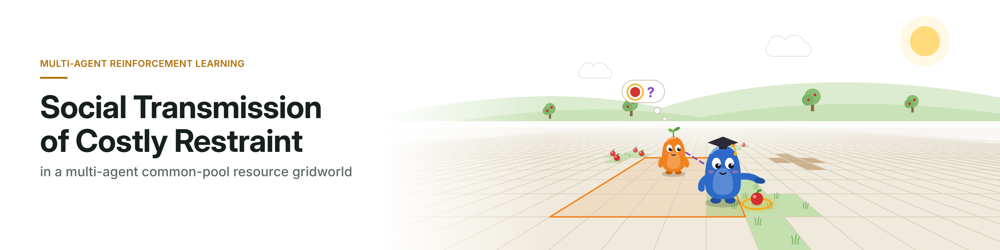

Can an agent that has learned to harvest a shared resource with restraint pass
that restraint on to a newcomer who only watches it, even when restraint costs
the newcomer reward?

This project studies that question with tabular reinforcement learning in a
small multi-agent gridworld. A frozen, restrained **teacher** and a naive,
learning **student** harvest apples from shared patches. Taking the last apple
of a patch can destroy the patch, so restraint protects the resource, but it
also means leaving reward behind. The student never sees the teacher's rewards
or values, only its positions and actions, and it is trained only on its own
reward. Whether, and how far, the teacher's restraint is transmitted is the
object of study.

**Author:** Mokwele Kegomoditswe, Department of Computer Science, University of Cape Town
**Supervisor:** Asad Jeewa

---

## Why this question

Research on **social learning** in reinforcement learning has shown that a naive
agent can acquire behaviour by observing an expert, but the behaviours studied
have been task skills that also benefit the learner, such as finding a goal or
shortening a route. Copying the expert was always in the learner's own interest.

Research on **social dilemmas** has shown how restraint and other cooperative
behaviours can be sustained among self-interested agents, but almost always
among peers that learn together, without a teacher.

This project sits between the two. In a common-pool resource, copying a
restrained harvester means earning less in the short term than a greedy
harvester would: the learner's own reward signal **opposes** the behaviour it
observes. Whether social learning still works when it has to compete with
self-interest is a different question from the ones already studied, and the
behaviours most worth transmitting between agents, such as restraint, fairness
and contribution to shared goods, are exactly the costly ones.

The project asks:

1. Does a restrained teacher transmit its restraint to a naive learner through
   observation alone?
2. How does transmission change as restraint becomes **more costly** for the learner?
3. How does it depend on **how restrained the teacher itself is**?
4. Does transmitted restraint **persist** once the teacher can no longer be observed?

---

## The environment

A two-agent gridworld written to the [PettingZoo](https://pettingzoo.farama.org/)
Parallel API, in the style of the *Commons Harvest* family of sequential social
dilemmas.

- **Grid:** $`10 \times 10`$ cells with four apple patches of five cells each.
- **Actions:** move up, down, left or right, or stay. Moves that would leave the
  grid are unavailable.
- **Reward:** $`+1`$ for moving onto an apple, which is then harvested.
- **Episodes:** a fixed length of $`T = 1500`$ steps.
- **Observation:** each agent sees apples within a radius of 4 cells, but
  observes the other agent's position and last action only within a radius
  of 2. The student must stay near the teacher to learn from it.

### Regrowth and the dilemma parameter $`\lambda`$

At every step, each empty patch cell regrows an apple with probability

```math
p(n;\lambda) = (1-\lambda)\,\bar p + \lambda\, p_{\mathrm{SJ}}(n),
```

where $`n`$ is the number of apples within a radius of two cells, $`\bar p = 0.001`$
is a constant rate, and $`p_{\mathrm{SJ}}`$ is the Commons Harvest regrowth rule:

| $`n`$ | 0 | 1 | 2 | $`\ge 3`$ |
|---|---|---|---|---|
| $`p_{\mathrm{SJ}}(n)`$ | 0 | 0.001 | 0.005 | 0.025 |

- At $`\lambda = 0`$, regrowth ignores the remaining stock: leaving an apple
  protects nothing, so restraint is **pointless** (the no-dilemma control).
- At $`\lambda = 1`$, a patch with no apples left **never regrows**.
- $`\lambda = \tfrac12`$ lies between the two.

The experiments use $`\lambda \in \{0, \tfrac12, 1\}`$.

### Restraint

An apple is **protected** when it is the last apple left in its patch, and
**restraint** means declining to take it. Restraint is about avoiding
depletion, not about harvesting as little as possible.

---

## Agents

### Scripted policies

- **Restrained** $`\pi_R`$: heads for the nearest apple but never takes a last apple.
- **Greedy** $`\pi_G`$: heads for the nearest apple and takes any apple, including last apples.

The two differ only at a **restraint opportunity**, a step at which a last apple
is adjacent. **Teacher levels** mix them there:

```math
\pi_T^{\rho} = \rho\pi_R + (1-\rho)\pi_G, \qquad \rho \in \{0.5,\ 0.75,\ 1\},
```

so the teacher takes an adjacent last apple with probability $`1-\rho`$ at each
step. Because taking an apple changes later opportunities, the nominal $`\rho`$
is not the realised restraint rate; the realised rate is **measured** and used
as the teacher's level. Because a learner trained alone does not learn
restraint (see Results), the teacher's restrained policy is the scripted $`\pi_R`$.

### The learner

A tabular Q-learner with learning rate $`\alpha`$ and discount factor $`\gamma`$:

```math
Q(s,a) \leftarrow Q(s,a) + \alpha \Big[ r + \gamma \max_{a'} Q(s',a') - Q(s,a) \Big],
```

acting through a softmax policy with inverse temperature $`\beta`$:

```math
\pi(a \mid s) = \frac{\exp\big(\beta Q(s,a)\big)}{\sum_{b} \exp\big(\beta Q(s,b)\big)}.
```

Episodes end by truncation, so the update always bootstraps from the next
state. Default settings: $`\alpha = 0.1`$, $`\gamma = 0.99`$, $`\beta = 5`$, initial values $`Q = 1`$.

The learner's state is a compact summary of what it sees (90 states):

| Feature | Values | Meaning |
|---|---|---|
| food | 9 | direction of the nearest ordinary apple, or of the grid centre if none is visible |
| protected direction | 5 | direction of the nearest last apple, or none |
| protected adjacent | 2 | whether that last apple is one step away (a restraint opportunity) |

### Social learning mechanisms

Two non-inferential mechanisms let the student use what it observes. Neither
gives it access to the teacher's rewards or values.

**Value shaping** raises the value of each state-action pair $`(s_e, a_e)`$ the
teacher is observed to take:

```math
Q(s_e, a_e) \leftarrow Q(s_e, a_e) + \kappa.
```

**Decision biasing** mixes the student's own policy with a social policy that
moves towards the teacher's last observed position:

```math
\pi_{\mathrm{DB}} = (1-\omega)\,\pi_{\mathrm{asoc}} + \omega\,\pi_{\mathrm{soc}}.
```

An **asocial** student, which receives no information about the teacher, is the
control. Value shaping acts only through learning; decision biasing acts at the
moment of choice, during training and evaluation alike.

The strengths $`\kappa`$ and $`\omega`$ were fixed before the main runs by a rule
chosen in advance: at $`\lambda = 0`$, with the fully restrained teacher, pick the
value that transmits **partially**, closest to halfway between the asocial
student and the teacher. This gave $`\kappa = 0.03`$ and $`\omega = 0.5`$, held
fixed in every condition.

---

## Measurement

### Restraint rate

A restraint opportunity is an **encounter**: the agent arrives next to a last
apple it was not next to on the previous step. Waiting beside the same apple is
one decision, however long it lasts. For agent $`i`$,

```math
\mathrm{Res}_i = 1 - \frac{\text{last apples taken by } i}{\text{encounters of } i},
```

excluding encounters ended by the other agent taking the apple first. A
per-step variant, counting every step spent beside a last apple, is reported as
a secondary measure; it is inflated when a restrained agent waits.

The pilot showed that the encounter count can be inflated too: a learner that
steps back and forth beside a last apple starts a new encounter on every
return (see Results). Restraint is therefore also measured **per apple**, where
each last apple counts once however often the agent comes back to it:

```math
\mathrm{Res}^{\mathrm{apple}}_i = 1 - \frac{\text{last apples taken by } i}{\text{distinct last apples } i \text{ was next to}},
```

where a "last apple" is one patch's spell in the last-apple state, from the
moment the patch is reduced to one apple until that apple is taken or the patch
regrows, and apples taken first by the other agent are excluded. Both rates are
reported.

Restraint is always read together with **collective return**, **survival time**
(steps until every patch is empty) and **patch losses by cause**, including
patches emptied when both agents take the last two apples in the same step,
which no individual restraint measure records.

### Is it a social dilemma? The cost of restraint

With $`R_c(\ell)`$ and $`R_d(\ell)`$ the student's return when it restrains or is
greedy and $`\ell \in \{0,1\}`$ other agents restrain, the game is a **social
dilemma** if

```math
R_c(1) > R_d(0), \qquad R_c(1) > R_c(0),
```

and at least one temptation holds: **fear**, $`R_d(0) > R_c(0)`$, or **greed**,
$`R_d(1) > R_c(1)`$. The **cost of restraint** is the greed gap

```math
\Delta = R_d(1) - R_c(1)
```

This is the extra return a student gets by taking last apples while its teacher
restrains. Restraint is individually costly exactly when $`\Delta > 0`$.

Returns are measured as the student experiences them: discounted with its own
$`\gamma`$, from **every** step of the episode, and averaged,

```math
\bar G = \frac{1}{T}\sum_{t=0}^{T-1} G_t, \qquad G_t = \sum_{k \ge 0} \gamma^{k}\, r_{t+k+1},
```

since the learner values every state it visits, not only the first.
Undiscounted returns and returns discounted from the start of the episode are
also reported.

### Transmission, persistence and partners

Every trained student is evaluated with learning switched off, on the same
evaluation episodes, in these settings:

| Setting | What changes | What it measures |
|---|---|---|
| full | the student observes the teacher throughout | $`A_{\mathrm{full}}`$ |
| half | observation is switched off halfway through each episode | $`A_{\mathrm{half}}`$ |
| off | the student never observes the teacher | behaviour without the teacher's information |
| after removal | the student **keeps learning** for 300 episodes without observing the teacher, then is evaluated | whether restraint **persists** when only the student's own reward shapes it |
| partners | the student plays beside a greedy agent, or beside a naive learner that learns as it plays | whether restraint holds with different partners |

Transmission is measured with the **cultural transmission** metric, applied to
restraint:

```math
\mathrm{CT} = \frac{1}{2}\,\frac{A_{\mathrm{full}} - A_{\mathrm{solo}}}{E} + \frac{1}{2}\,\frac{A_{\mathrm{half}} - A_{\mathrm{solo}}}{E},
```

where $`A_{\mathrm{full}}`$, $`A_{\mathrm{half}}`$ and $`A_{\mathrm{solo}}`$ are the
student's restraint with the teacher observable throughout, observable for the
first half of each episode, and never observable (the asocial student), and $`E`$
is the teacher's own restraint. $`\mathrm{CT} = 1`$ means the student matched the
teacher, and a confidence interval that includes zero means no evidence of
transmission. Because $`\mathrm{CT}`$ divides by the teacher's own restraint, the
effect of the teacher's level is compared with the **raw gain**
$`A_{\mathrm{full}} - A_{\mathrm{solo}}`$ instead. The unit of analysis is the
independent training run; results are means with 95% bootstrap confidence
intervals over runs.

---

## Results so far

### The environment is a social dilemma where it should be

Scripted restrained and greedy students were paired with a greedy partner and
with the teacher at each level, with **200 seeds per pairing**. Returns are
measured as the learner experiences them (discounted with $`\gamma = 0.99`$,
averaged over all steps). A condition counts only when its 95% interval
excludes zero.

| $`\lambda`$ | Social dilemma? | Greed gap $`\Delta`$ [95% CI], teacher level $`\rho = 0.5`$ | $`\rho = 0.75`$ | $`\rho = 1`$ |
|---|---|---|---|---|
| 0 | no | $`+0.97\ [0.93, 1.01]`$ | $`+0.95\ [0.91, 0.99]`$ | $`+0.94\ [0.90, 0.98]`$ |
| $`\tfrac12`$ | **yes** (fear and greed), at every level | $`+0.27\ [0.24, 0.29]`$ | $`+0.24\ [0.22, 0.27]`$ | $`+0.18\ [0.15, 0.20]`$ |
| 1 | **yes** (fear only), at every level | $`-0.32\ [-0.34, -0.30]`$ | $`-0.37\ [-0.39, -0.35]`$ | $`-0.63\ [-0.66, -0.60]`$ |

- **$`\lambda = 0`$** is the control: restraint costs the student reward and protects nothing.
- **$`\lambda = \tfrac12`$** is the core condition: restraint is both **individually
  costly** ($`\Delta > 0`$) and **collectively valuable** (a social dilemma), at
  every teacher level.
- **$`\lambda = 1`$** is a dilemma only through fear; beside the teacher,
  restraint **pays** the student ($`\Delta < 0`$).
- At $`\lambda = \tfrac12`$ the cost of restraint **falls as the teacher becomes
  more restrained**: a restrained teacher keeps patches alive, so restraint
  costs the student less. Teacher level and cost are therefore linked, and
  transmission is analysed against the measured $`\Delta`$ of each condition.
- Measured from the start of an episode instead, no setting is a dilemma:
  within the learner's horizon from the start, restraint never pays back.


### A lone learner does not learn restraint

A Q-learner trained alone at $`\lambda = 1`$ ended up no more restrained than a
greedy agent, in all three seeds, even though restraint doubles a lone agent's
harvest:

| | Restraint per encounter | Return |
|---|---|---|
| learner, seed 0 | 0.03 | 22.9 |
| learner, seed 1 | 0.00 | 21.3 |
| learner, seed 2 | 0.78 | 20.3 |
| scripted greedy $`\pi_G`$ | 0.00 | 20.2 |
| scripted restrained $`\pi_R`$ | 1.00 | 41.0 |

Seed 2's high rate is misleading on its own: it repeatedly walks up to last
apples and leaves, but still takes about three per episode, and its return is
no better than greedy. This is why restraint is always read together with the
apples actually taken and the return.

The environment is not at fault: restraint doubles the harvest, and averaged
over the states the learner visits, its own discounted objective favours
restraint. But the reward for taking a last apple is immediate, while its cost
arrives hundreds of steps later, and the learner's state does not reveal how
far into the episode it is. **Restraint is profitable but hard to learn alone**,
which is exactly the situation in which a teacher could help. The teacher in
the experiments is therefore the scripted restrained policy $`\pi_R`$.

### The three teacher levels

Measured alone at $`\lambda = 1`$ over 50 episodes:

| Teacher level $`\rho`$ | Restraint per encounter [95% CI] | Last apples taken per episode | All patches died |
|---|---|---|---|
| 0.5 | 0.25 [0.20, 0.29] | 3.60 | 62% |
| 0.75 | 0.43 [0.37, 0.48] | 3.54 | 58% |
| 1 | 1.00 [1.00, 1.00] | 0.00 | 0% |

The levels are clearly distinct. The realised restraint is well below the
nominal $`\rho`$, because the teacher draws at **every step** a last apple is
adjacent, and often waits beside one for several steps. The measured rates,
not $`\rho`$, are the teacher levels. Even 43% restraint destroys the resource
in most episodes: at $`\lambda = 1`$ a single lapse kills a patch for good.

### Pilot: does restraint transmit? *(3 runs per condition; exploratory)*

Students were trained for 600 episodes beside the fully restrained teacher
($`\rho = 1`$) at each $`\lambda`$. With only three runs per condition these
results show what the full design should test; they are not strong evidence.
Restraint below is **per encounter**; the per-apple values are being measured.

| | $`\lambda`$ | Restraint $`A_{\mathrm{full}}`$ | Last apples taken per episode | Collective return | CT [95% CI] |
|---|---|---|---|---|---|
| asocial | 0 | 0.04 | 21.6 | 45.3 | |
| asocial | $`\tfrac12`$ | 0.02 | 13.7 | 36.4 | |
| asocial | 1 | 0.03 | 2.7 | 28.2 | |
| value shaping | 0 | 0.83 | 2.5 | 38.9 | 0.79 [0.71, 0.88] |
| value shaping | $`\tfrac12`$ | 0.67 | 2.0 | 38.7 | 0.65 [0.63, 0.68] |
| value shaping | 1 | 0.76 | 1.4 | 34.9 | 0.73 [0.65, 0.80] |
| decision biasing | 0 | 0.37 | 18.9 | 44.5 | 0.28 [0.20, 0.34] |
| decision biasing | $`\tfrac12`$ | 0.37 | 14.1 | 36.1 | 0.30 [0.28, 0.32] |
| decision biasing | 1 | 0.30 | 3.8 | 22.6 | 0.26 [0.22, 0.30] |

**Value shaping transmits restraint at every $`\lambda`$, and the returns follow
the dilemma.** Compared with an asocial student, a value-shaping student's own
return and the collective return change by:

| $`\lambda`$ | Student | Collective | Reading |
|---|---|---|---|
| 0 | $`-14.2`$ | $`-6.4`$ | restraint is wasted: patches regrow anyway |
| $`\tfrac12`$ | $`-7.5`$ | $`+2.3`$ | a social dilemma: the student pays, the group gains |
| 1 | $`+1.6`$ | $`+6.6`$ | restraint pays the student and the group |

**Decision biasing raises the measured rate, but not the protection of the
resource.** Following the teacher leads the student to more last apples, which
its own values then take: last apples taken do not fall at $`\lambda = \tfrac12`$
and rise at $`\lambda = 1`$, where all four patches are lost in 93% of episodes
(asocial: 13%). Its restraint exists only while the teacher is visible: it
drops when observation is switched off halfway, and with the teacher never
observed it is 0.17, 0.00 and 0.00.

**Transmitted restraint persists after the teacher is removed, eroding most
where it is costly.** After 300 further episodes of learning without the
teacher (restraint per encounter):

| | $`\lambda = 0`$ | $`\lambda = \tfrac12`$ | $`\lambda = 1`$ |
|---|---|---|---|
| value shaping, before → after | 0.83 → 0.74 | 0.67 → 0.55 | 0.76 → 0.78 |
| decision biasing, before → after | 0.37 → 0.08 | 0.37 → 0.02 | 0.30 → 0.95 * |
| asocial, after | 0.04 | 0.07 | 0.01 |

Value-shaping restraint does not erode where it pays the student
($`\lambda = 1`$) and erodes most where it costs the student reward
($`\lambda = \tfrac12`$). Decision-biasing restraint disappears.

\* This value is an artefact. These students alternate between two cells beside
a last apple, a loop caused by two different cells mapping to states whose best
actions point at each other, and every return starts a new encounter: up to 121
encounters per episode against about 3 for asocial students. They do take fewer
last apples than before removal (about 2 per episode instead of 3.4–3.9), so
part of the effect may be real. This finding is why restraint is now also
measured per apple.

**Restraint here looks like waiting, not passivity.** Once every patch is down
to its last apple, nothing is harvestable for 86–93% of steps, and the scripted
teacher stands still for most of the episode. Value-shaping students wait
beside the last apple, but almost never stand still while an ordinary apple is
in view (0.3–0.6% of steps; the teacher 3–7%). Their loss of return is the last
apples they leave, not food they ignore.

## Project status

| Stage | Contents | Status |
|---|---|---|
| Environment | gridworld, scripted policies, social-dilemma validation | complete |
| Teacher | tabular Q-learner, teacher training, three measured teacher levels | complete |
| Students | asocial, value shaping, decision biasing; parameter selection; pilot | complete |
| Evaluation | transmission, persistence after the teacher is removed, partner tests | built; pilot complete |
| Full design | three teacher levels × three $`\lambda`$ × three conditions, more runs; analysis and report | next |

---

## Project structure

```
commons_env/              the environment
  env.py                  gridworld, regrowth, social channel, restraint bookkeeping
  scripted.py             restrained, greedy and teacher-level policies
  metrics.py              restraint rate, per encounter and per step
agents/                   learning agents
  features.py             the learner's state; wall mask
  q_learner.py            tabular Q-learning with softmax
  runner.py               training and evaluation episodes; frozen teacher
  social.py               value shaping and decision biasing
scripts/
  check_gate.py           social-dilemma validation and the cost of restraint
  train_teacher.py        train a Q-learner teacher alone
  make_teacher_levels.py  build and measure the three teacher levels
  train_student.py        train one student beside the teacher
  run_batch.py            train many students in parallel (resumable)
  summarise_students.py   summarise trained students by condition
  select_social_param.py  choose kappa and omega by the rule fixed in advance
  stillness_check.py      teacher and student stillness: waiting or passivity?
  phase3_eval.py          transmission, persistence after removal, partner tests
  summarise_phase3.py     CT, raw gain and persistence with bootstrap intervals
  view.py                 graphical viewer; loads trained students; records MP4 video
tests/                    unit and integration tests
results/                  outputs, kept in full, including unsuccessful runs
EXPERIMENT_LOG.md         a dated record of every run and decision
```

---

## Installation

Requires Python 3.11 or newer. From the project folder:

**Windows (PowerShell)**

```powershell
python -m venv .venv
.venv\Scripts\Activate.ps1
python -m pip install -r requirements.txt
python -m pip install -e .
python -m pytest -q
```

**macOS / Linux**

```bash
python3 -m venv .venv
source .venv/bin/activate
python -m pip install -r requirements.txt
python -m pip install -e .
python -m pytest -q
```

All tests should pass. They include PettingZoo's official API and determinism checks.

---

## Usage

**Watch the environment** (both agents scripted):

```bash
python scripts/view.py                                      # restrained teacher, greedy student
python scripts/view.py --student restrained                 # restrained student
python scripts/view.py --lam 0.5 --teacher mixed --rho 0.5  # a less restrained teacher
```

Controls: SPACE pause, RIGHT one step, UP/DOWN speed, R new episode, S screenshot,
V start/stop recording an MP4 video (saved in `results/videos/`), ESC quit.

**Watch a trained student**, or record one directly:

```bash
python scripts/view.py --lam 0.5 --student-q results/pilot/value_shaping_k0.03_lam0.5_rho1.0_s0.npz --social
python scripts/view.py --lam 0.5 --student-q <student>.npz --social --record clip.mp4 --record-steps 600
```

**Check that the environment is a social dilemma** and measure the cost of restraint:

```bash
python scripts/check_gate.py --seeds 50
```

**Train a teacher** alone at $`\lambda = 1`$ and check whether it is reliably restrained:

```bash
python scripts/train_teacher.py --seed 0
```

**Build and measure the three teacher levels**:

```bash
python scripts/make_teacher_levels.py --teacher scripted
```

**Train students** (one run, or a resumable batch in parallel) and summarise them:

```bash
python scripts/train_student.py --condition value_shaping --kappa 0.03 --lam 0.5 --seed 0
python scripts/run_batch.py --conditions asocial value_shaping decision_biasing --kappa 0.03 --omega 0.5 \
    --lams 0.0 0.5 1.0 --rho 1.0 --seeds 0 1 2 --out-dir results/pilot
python scripts/summarise_students.py results/pilot
```

**Evaluate transmission, persistence and partners**, then summarise:

```bash
python scripts/phase3_eval.py results/pilot
python scripts/summarise_phase3.py results/pilot
python scripts/stillness_check.py results/pilot
```

---

## Reproducibility

- Every run is seeded; the same command reproduces the same numbers exactly.
- Training and evaluation use disjoint random seeds.
- Package versions are pinned in `requirements.txt`.
- `EXPERIMENT_LOG.md` records every run that informed a decision, including
  failed ones, with the exact command and the reason for it.

---

## Key references

- Bhoopchand, A. et al. (2023). Learning few-shot imitation as cultural transmission. *Nature Communications*, 14, 7536.
- Cook, J., Lu, C., Hughes, E., Leibo, J. Z. and Foerster, J. (2024). Artificial generational intelligence: Cultural accumulation in reinforcement learning. *NeurIPS*.
- Guo, Z. et al. (2026). SocialJax: An evaluation suite for multi-agent reinforcement learning in sequential social dilemmas. *ICLR*.
- Keßler, S., Bautista-Salinero, M., Tennie, C. and Wu, C. M. (2026). Emergent social transmission of model-based representations without inference. arXiv:2604.05777.
- Leibo, J. Z., Zambaldi, V., Lanctot, M., Marecki, J. and Graepel, T. (2017). Multi-agent reinforcement learning in sequential social dilemmas. *AAMAS*.
- Perolat, J. et al. (2017). A multi-agent reinforcement learning model of common-pool resource appropriation. *NeurIPS*.
- Terry, J. K. et al. (2021). PettingZoo: Gym for multi-agent reinforcement learning. *NeurIPS*.

---

## Licence

MIT. See [LICENSE](LICENSE).
