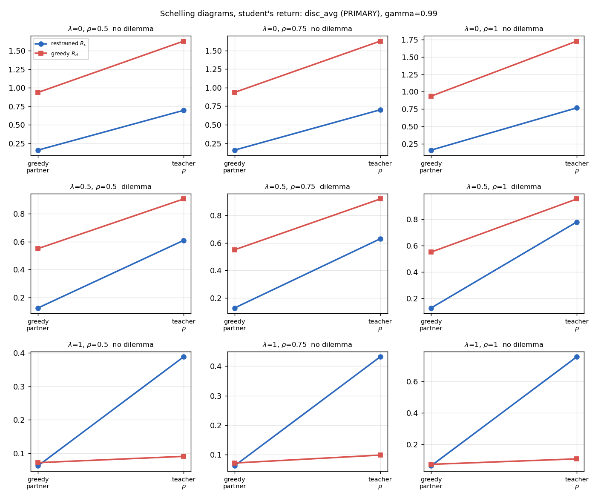

# Social Transmission of Costly Restraint in a Multi-Agent Common-Pool Resource Gridworld

Can an agent that has learned to harvest a shared resource with restraint pass
that restraint on to a newcomer who only watches it, even when restraint costs
the newcomer reward?

This project studies that question with tabular reinforcement learning in a
small multi-agent gridworld. A frozen, restrained **teacher** and a naive,
learning **student** harvest apples from shared patches. Taking the last apple
of a patch can destroy the patch, so restraint protects the resource, but it
also means leaving reward behind. The student never sees the teacher's rewards
or values, only its positions and actions, and it is trained only on its own
reward. Whether, and how far, the teacher's restraint is transmitted is the
object of study.

**Author:** Mokwele Kegomoditswe, Department of Computer Science, University of Cape Town
**Supervisor:** Asad Jeewa

---

## Why this question

Research on **social learning** in reinforcement learning has shown that a naive
agent can acquire behaviour by observing an expert, but the behaviours studied
have been task skills that also benefit the learner, such as finding a goal or
shortening a route. Copying the expert was always in the learner's own interest.

Research on **social dilemmas** has shown how restraint and other cooperative
behaviours can be sustained among self-interested agents, but almost always
among peers that learn together, without a teacher.

This project sits between the two. In a common-pool resource, copying a
restrained harvester means earning less in the short term than a greedy
harvester would: the learner's own reward signal **opposes** the behaviour it
observes. Whether social learning still works when it has to compete with
self-interest is a different question from the ones already studied, and the
behaviours most worth transmitting between agents, such as restraint, fairness
and contribution to shared goods, are exactly the costly ones.

The project asks:

1. Does a restrained teacher transmit its restraint to a naive learner through
   observation alone?
2. How does transmission change as restraint becomes **more costly** for the learner?
3. How does it depend on **how restrained the teacher itself is**?
4. Does transmitted restraint **persist** once the teacher can no longer be observed?

---

## The environment

A two-agent gridworld written to the [PettingZoo](https://pettingzoo.farama.org/)
Parallel API, in the style of the *Commons Harvest* family of sequential social
dilemmas.

- **Grid:** $10 \times 10$ cells with four apple patches of five cells each.
- **Actions:** move up, down, left or right, or stay. Moves that would leave the
  grid are unavailable.
- **Reward:** $+1$ for moving onto an apple, which is then harvested.
- **Episodes:** a fixed length of $T = 1500$ steps.
- **Observation:** each agent sees apples within a radius of 4 cells, but
  observes the other agent's position and last action only within a radius
  of 2. The student must stay near the teacher to learn from it.

### Regrowth and the dilemma parameter $\lambda$

At every step, each empty patch cell regrows an apple with probability

$$
p(n;\lambda) = (1-\lambda)\,\bar p + \lambda\, p_{\mathrm{SJ}}(n),
$$

where $n$ is the number of apples within a radius of two cells, $\bar p = 0.001$
is a constant rate, and $p_{\mathrm{SJ}}$ is the Commons Harvest regrowth rule:

| $n$ | 0 | 1 | 2 | $\ge 3$ |
|---|---|---|---|---|
| $p_{\mathrm{SJ}}(n)$ | 0 | 0.001 | 0.005 | 0.025 |

- At $\lambda = 0$, regrowth ignores the remaining stock: leaving an apple
  protects nothing, so restraint is **pointless** (the no-dilemma control).
- At $\lambda = 1$, a patch with no apples left **never regrows**.
- $\lambda = \tfrac12$ lies between the two.

The experiments use $\lambda \in \{0, \tfrac12, 1\}$.

### Restraint

An apple is **protected** when it is the last apple left in its patch, and
**restraint** means declining to take it. Restraint is about avoiding
depletion, not about harvesting as little as possible.

---

## Agents

### Scripted policies

- **Restrained** $\pi_R$: heads for the nearest apple but never takes a last apple.
- **Greedy** $\pi_G$: heads for the nearest apple and takes any apple, including last apples.

The two differ only at a **restraint opportunity**, a step at which a last apple
is adjacent. **Teacher levels** mix them there:

$$
\pi_T^{\rho} = \rho\,\pi_R + (1-\rho)\,\pi_G, \qquad \rho \in \{0.5,\ 0.75,\ 1\},
$$

so the teacher takes an adjacent last apple with probability $1-\rho$ at each
step. Because taking an apple changes later opportunities, the nominal $\rho$
is not the realised restraint rate; the realised rate is **measured** and used
as the teacher's level.

### The learner

A tabular Q-learner with learning rate $\alpha$ and discount factor $\gamma$:

$$
Q(s,a) \leftarrow Q(s,a) + \alpha \Big[ r + \gamma \max_{a'} Q(s',a') - Q(s,a) \Big],
$$

acting through a softmax policy with inverse temperature $\beta$:

$$
\pi(a \mid s) = \frac{\exp\!\big(\beta\, Q(s,a)\big)}{\sum_{b} \exp\!\big(\beta\, Q(s,b)\big)}.
$$

Episodes end by truncation, so the update always bootstraps from the next
state. Default settings: $\alpha = 0.1$, $\gamma = 0.99$, $\beta = 5$, initial values $Q = 1$.

The learner's state is a compact summary of what it sees (90 states):

| Feature | Values | Meaning |
|---|---|---|
| food | 9 | direction of the nearest ordinary apple, or of the grid centre if none is visible |
| protected direction | 5 | direction of the nearest last apple, or none |
| protected adjacent | 2 | whether that last apple is one step away (a restraint opportunity) |

### Social learning mechanisms *(in development)*

Two non-inferential mechanisms let the student use what it observes.

**Value shaping** raises the value of each state-action pair $(s_e, a_e)$ the
teacher is observed to take:

$$
Q(s_e, a_e) \leftarrow Q(s_e, a_e) + \kappa.
$$

**Decision biasing** mixes the student's own policy with a social policy that
moves towards the teacher's last observed position:

$$
\pi_{\mathrm{DB}} = (1-\omega)\,\pi_{\mathrm{asoc}} + \omega\,\pi_{\mathrm{soc}}.
$$

An **asocial** student, which ignores the teacher, is the control.

---

## Measurement

### Restraint rate

A restraint opportunity is an **encounter**: the agent arrives next to a last
apple it was not next to on the previous step. Waiting beside the same apple is
one decision, however long it lasts. For agent $i$,

$$
\mathrm{Res}_i = 1 - \frac{\text{last apples taken by } i}{\text{encounters of } i},
$$

excluding encounters ended by the other agent taking the apple first. A
per-step variant, counting every step spent beside a last apple, is reported as
a secondary measure; it is inflated when a restrained agent waits.

Restraint is always read together with **collective return**, **survival time**
(steps until every patch is empty) and **patch losses by cause**, including
patches emptied when both agents take the last two apples in the same step,
which no individual restraint measure records.

### Is it a social dilemma? The cost of restraint

With $R_c(\ell)$ and $R_d(\ell)$ the student's return when it restrains or is
greedy and $\ell \in \{0,1\}$ other agents restrain, the game is a **social
dilemma** if

$$
R_c(1) > R_d(0), \qquad R_c(1) > R_c(0),
$$

and at least one temptation holds: **fear**, $R_d(0) > R_c(0)$, or **greed**,
$R_d(1) > R_c(1)$. The **cost of restraint** is the greed gap

$$
\Delta = R_d(1) - R_c(1):
$$

the extra return a student gets by taking last apples while its teacher
restrains. Restraint is individually costly exactly when $\Delta > 0$.

Returns are measured as the student experiences them: discounted with its own
$\gamma$, from **every** step of the episode, and averaged,

$$
\bar G = \frac{1}{T}\sum_{t=0}^{T-1} G_t, \qquad G_t = \sum_{k \ge 0} \gamma^{k}\, r_{t+k+1},
$$

since the learner values every state it visits, not only the first.
Undiscounted returns and returns discounted from the start of the episode are
also reported.

### Transmission *(in development)*

Transmission is measured with the **cultural transmission** metric, applied to
restraint:

$$
\mathrm{CT} = \frac{1}{2}\,\frac{A_{\mathrm{full}} - A_{\mathrm{solo}}}{E} + \frac{1}{2}\,\frac{A_{\mathrm{half}} - A_{\mathrm{solo}}}{E},
$$

where $A_{\mathrm{full}}$, $A_{\mathrm{half}}$ and $A_{\mathrm{solo}}$ are the
student's restraint with the teacher observable throughout, observable for the
first half of each episode, and never observable (the asocial student), and $E$
is the teacher's own restraint. $\mathrm{CT} = 1$ means the student matched the teacher.

---

## Results so far

### The environment is a social dilemma where it should be

Scripted restrained and greedy students were paired with a greedy partner and
with the teacher at each level, 50 seeds per pairing (200 seeds for the
uncertain $\lambda = 1$ comparison). Primary measure: discounted, averaged returns.

| $\lambda$ | Social dilemma? | Greed gap $\Delta$ (fully restrained teacher) | What it means for the student |
|---|---|---|---|
| 0 | no | $+0.96$ | restraint costs reward and protects nothing |
| $\tfrac12$ | **yes**, at every teacher level | $+0.17$ to $+0.30$ | restraint is **costly and collectively valuable** |
| 1 | yes, weakly (fear only) | $-0.65$ | beside a restrained teacher, restraint **pays** |

The cost of restraint therefore ranges from clearly positive to clearly
negative across the settings, and $\lambda = \tfrac12$ is the condition in which
restraint is both individually costly and socially valuable. Discounted from
the start of the episode, no setting is a dilemma: within the learner's
horizon from the start, restraint never pays back.



### Next results

The teacher's three restraint levels, and then the students' learning, are in
progress; see the roadmap below.

---

## Project status

| Stage | Contents | Status |
|---|---|---|
| Environment | gridworld, scripted policies, dilemma validation | ✅ complete |
| Teacher | tabular Q-learner, teacher training, three measured teacher levels | 🔄 in progress |
| Students | asocial, value shaping, decision biasing; pilot | ⬜ planned |
| Evaluation | CT metric, persistence after the teacher is removed, partner tests, analysis | ⬜ planned |

---

## Project structure

```
commons_env/              the environment
  env.py                  gridworld, regrowth, social channel, restraint bookkeeping
  scripted.py             restrained, greedy and teacher-level policies
  metrics.py              restraint rate, per encounter and per step
agents/                   learning agents
  features.py             the learner's state; wall mask
  q_learner.py            tabular Q-learning with softmax
  runner.py               training and evaluation episodes; frozen teacher
scripts/
  check_gate.py           social-dilemma validation and the cost of restraint
  train_teacher.py        train a Q-learner teacher alone
  make_teacher_levels.py  build and measure the three teacher levels
  view.py                 graphical viewer
tests/                    unit and integration tests
results/                  outputs, kept in full, including unsuccessful runs
EXPERIMENT_LOG.md         a dated record of every run and decision
```

---

## Installation

Requires Python 3.11 or newer. From the project folder:

**Windows (PowerShell)**

```powershell
python -m venv .venv
.venv\Scripts\Activate.ps1
python -m pip install -r requirements.txt
python -m pip install -e .
python -m pytest -q
```

**macOS / Linux**

```bash
python3 -m venv .venv
source .venv/bin/activate
python -m pip install -r requirements.txt
python -m pip install -e .
python -m pytest -q
```

All tests should pass. They include PettingZoo's official API and determinism checks.

---

## Usage

**Watch the environment** (both agents scripted):

```bash
python scripts/view.py                                      # restrained teacher, greedy student
python scripts/view.py --student restrained                 # restrained student
python scripts/view.py --lam 0.5 --teacher mixed --rho 0.5  # a less restrained teacher
```

Controls: SPACE pause, RIGHT one step, UP/DOWN speed, R new episode, S screenshot, ESC quit.

**Check that the environment is a social dilemma** and measure the cost of restraint:

```bash
python scripts/check_gate.py --seeds 50
```

**Train a teacher** alone at $\lambda = 1$ and check whether it is reliably restrained:

```bash
python scripts/train_teacher.py --seed 0
```

**Build and measure the three teacher levels**:

```bash
python scripts/make_teacher_levels.py --teacher scripted
```

---

## Reproducibility

- Every run is seeded; the same command reproduces the same numbers exactly.
- Training and evaluation use disjoint random seeds.
- Package versions are pinned in `requirements.txt`.
- `EXPERIMENT_LOG.md` records every run that informed a decision, including
  failed ones, with the exact command and the reason for it.

---

## Key references

- Bhoopchand, A. et al. (2023). Learning few-shot imitation as cultural transmission. *Nature Communications*, 14, 7536.
- Cook, J., Lu, C., Hughes, E., Leibo, J. Z. and Foerster, J. (2024). Artificial generational intelligence: Cultural accumulation in reinforcement learning. *NeurIPS*.
- Guo, Z. et al. (2026). SocialJax: An evaluation suite for multi-agent reinforcement learning in sequential social dilemmas. *ICLR*.
- Keßler, S., Bautista-Salinero, M., Tennie, C. and Wu, C. M. (2026). Emergent social transmission of model-based representations without inference. arXiv:2604.05777.
- Leibo, J. Z., Zambaldi, V., Lanctot, M., Marecki, J. and Graepel, T. (2017). Multi-agent reinforcement learning in sequential social dilemmas. *AAMAS*.
- Perolat, J. et al. (2017). A multi-agent reinforcement learning model of common-pool resource appropriation. *NeurIPS*.
- Terry, J. K. et al. (2021). PettingZoo: Gym for multi-agent reinforcement learning. *NeurIPS*.

---

## Licence

MIT. See [LICENSE](LICENSE).
